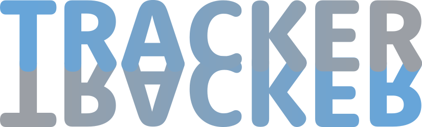
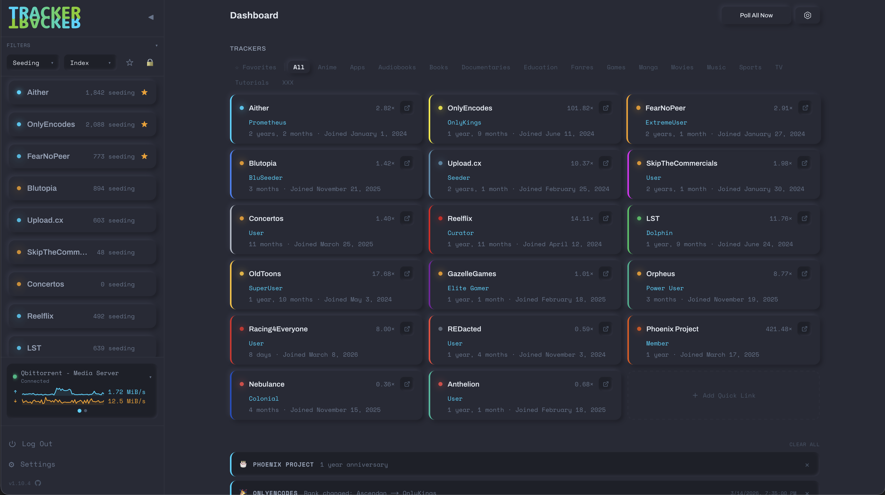
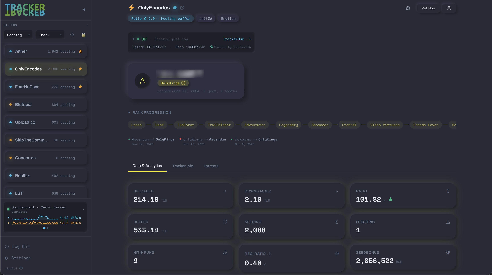

[](https://jordanlambrecht.github.io/tracker-tracker/)

<p align="center">
  
</p>

Self-hosted dashboard for monitoring private tracker stats over time. Track upload, download, ratio, buffer, seedbonus, and rank across all your trackers from one place.

## Features

- Per-tracker and fleet-wide stats with 30+ charts
- UNIT3D, Gazelle, GGn, Nebulance, MAM, and AvistaZ network support out of the box
- qBittorrent and Transmission integration, with cross-seed tracking, activity heatmaps, and speed history ([download clients](https://jordanlambrecht.github.io/tracker-tracker/features/download-clients/))
- Prowlarr integration that shows each tracker's indexer status and stats from one or more Prowlarr instances
- Everything stays on your machine. No telemetry, no phoning home.

## Screenshots

<p align="center">
  
</p>

<p align="center">
  
</p>

More screenshots are in the [docs folder](https://github.com/jordanlambrecht/tracker-tracker/tree/main/docs).

## Supported trackers

Verified (tested against a live account): Aither, AnimeZ, Anthelion, AvistaZ, Blutopia, C411, CinemaZ, Concertos, DarkPeers, DigitalCore.Club, FearNoPeer, FileList, GazelleGames, HAWKE-UNO, IPTorrents, LST, MyAnonaMouse, Nebulance, OldToons, OnlyEncodes, Orpheus, Phoenix Project, Racing4Everyone, REDacted, ReelFliX, RetroToon World, seedpool, SkipTheCommercials, TorrentLeech, Upload.cx, Yu-Scene.

Unverified (the adapter exists but has not been tested against a live account): AlphaRatio, AnimeBytes, BroadcasTheNet, Cathode-Ray.Tube, DreadVault, Empornium, ExoticaZ, Great Poster Wall, InfinityHD, Luminarr, MoreThanTV, PassThePopcorn, PrivateHD, Retro Movies Club, RocketHD, SeedCore, TR4KER, Zenith.

Not supported yet: 720pier, AB Torrents, AsianCinema, BeyondHD, Bibliotik, Cinemageddon, HDBits, HD-Torrents, Portugas, Secret Cinema, Sportscult, TV-Vault, UHDBits.

## Quick Start

```bash
mkdir tracker-tracker && cd tracker-tracker
```

1. Download the compose file and example env:

   ```bash
   curl -LO https://raw.githubusercontent.com/jordanlambrecht/tracker-tracker/main/docker-compose.yml
   curl -L https://raw.githubusercontent.com/jordanlambrecht/tracker-tracker/main/.env.example -o .env
   ```

2. Generate secrets and paste them into `.env`:

   ```bash
   # Run these, then copy the output into .env
   openssl rand -base64 24   # → POSTGRES_PASSWORD
   openssl rand -base64 48   # → SESSION_SECRET
   ```

   Keep `SESSION_SECRET` safe and never change it, because it wraps your encryption key.

3. Start the stack:

   ```bash
   docker compose up -d
   ```

4. Visit `http://localhost:3000` to set your master password and start adding trackers.

To update:

```bash
docker compose pull && docker compose up -d
```

The database schema is synced automatically on startup.

Environment variables, volumes, ports, and reverse proxy examples are in [Docker Configuration](https://jordanlambrecht.github.io/tracker-tracker/getting-started/docker-config/). To use an existing Postgres, see [Using an external database](https://jordanlambrecht.github.io/tracker-tracker/getting-started/installation/#using-an-external-database).

## Locked out?

There is no "forgot password" email. The app container ships a recovery command instead:

```bash
docker exec -it tracker-tracker-app tt-recover --check    # can I recover? writes nothing
```

Do not edit `password_hash` by hand. Every stored secret is encrypted with a key derived from your master password, so a hand edit orphans all of them permanently. The full walkthrough is in [Lost Master Password](https://jordanlambrecht.github.io/tracker-tracker/reference/password-recovery/).

## Documentation

Full documentation is at **[jordanlambrecht.github.io/tracker-tracker](https://jordanlambrecht.github.io/tracker-tracker/)**.

- [Installation](https://jordanlambrecht.github.io/tracker-tracker/getting-started/installation/)
- [Adding a tracker](https://jordanlambrecht.github.io/tracker-tracker/trackers/adding-a-tracker/)
- [Troubleshooting](https://jordanlambrecht.github.io/tracker-tracker/troubleshooting/)

## Contributing

PRs welcome. To run the app from source, see [Local Development](https://jordanlambrecht.github.io/tracker-tracker/contributing/local-development/). [Adding a tracker](https://jordanlambrecht.github.io/tracker-tracker/contributing/adding-a-tracker/) has the full guide for new trackers. Start from [`_template.ts`](https://github.com/jordanlambrecht/tracker-tracker/blob/main/src/data/trackers/_template.ts). Partial entries are fine if you set `draft: true`.

Other places help is useful:

- Download client adapters for Deluge and rTorrent. See [`src/lib/download-clients/`](https://github.com/jordanlambrecht/tracker-tracker/tree/main/src/lib/download-clients) for the pattern: an adapter under `adapters/`, its transport in a sibling folder, and one `case` in `factory.ts`.
- Adapters for trackers that do not run a supported platform (see the [adapter standard](https://jordanlambrecht.github.io/tracker-tracker/contributing/adapter-standard/))
- Verifying a tracker from the unverified list above against a live account
- Security review (see [SECURITY.md](https://github.com/jordanlambrecht/tracker-tracker/blob/main/SECURITY.md))
- Feedback on other screen sizes, since I only have a 16" MBP to test on
- Charts and data visualization

Tracker Tracker is free and independently maintained. [GitHub Sponsors](https://github.com/sponsors/jordanlambrecht) for recurring support, [Buy Me a Coffee](https://buymeacoffee.com/jordyjordy) for a one-off.

## Built with

Next.js 16 (App Router), PostgreSQL with Drizzle ORM, ECharts, node-cron, Argon2, and jose.

## License

[GPL-3.0](https://github.com/jordanlambrecht/tracker-tracker/blob/main/LICENSE)
