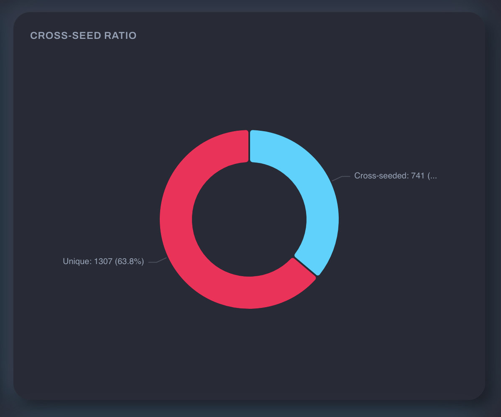

# Download Clients

Tracker Tracker connects to qBittorrent's web interface to pull live torrent data. This powers the Torrents tab with active downloads and uploads, speeds, seeding counts, ratio histograms, and cross-seed stats.

## Supported Clients

| Client       | Status      |
| ------------ | ----------- |
| qBittorrent  | Supported   |
| Deluge       | Coming soon |
| Transmission | Coming soon |
| rTorrent     | Coming soon |

## Adding a Client

Go to **Settings → Download Clients** and fill in your connection details:

| Field    | Notes                                                                                                                                      |
| -------- | ------------------------------------------------------------------------------------------------------------------------------------------ |
| Name     | A label for this client                                                                                                                    |
| Host     | Hostname or IP, do **not** include `http://` or `https://`                                                                                 |
| Port     | Default qBittorrent Web UI port is `8080`                                                                                                  |
| Username | qBittorrent Web UI username                                                                                                                |
| Password | qBittorrent Web UI password                                                                                                                |
| Use SSL  | Enable if your qBittorrent Web UI is served over HTTPS                                                                                     |
| URL path | Optional. For a reverse proxy, or Qui's client proxy at `<base path>/proxy/<client API key>`. Stored encrypted and shown masked            |

!!! warning "SSL/port mismatch"
    The form will warn you if SSL is on with port 80, or SSL is off with port 443. These combinations are usually misconfigured. You can still save, but double-check your settings.

!!! tip "Qui"
    To go through Qui, set Host and Port to Qui's and the URL path to its client proxy, `<base path>/proxy/<client API key>`.
    Leave the username and password blank. Qui answers the qBittorrent login itself.
    If Qui is served over HTTPS, turn on **Use SSL** on the client's card after adding it.

After saving, use the **Test Connection** button to confirm Tracker Tracker can reach and authenticate with qBittorrent.

## Linking Trackers to a Client

A torrent with a tracker's **qBittorrent tag** goes to that tracker. A torrent without one is matched by its announce domain, ignoring subdomains, against each tracker's site and any other domains Tracker Tracker knows it announces on. If a torrent's tag and announce domain point to different trackers, the tag wins. Tags are optional for torrent lists and fleet stats, but the per-tag speed and seeding charts and the movers in Today at a Glance count tagged torrents only. To set a tag, open the tracker's settings and fill in the qBittorrent tag field.

## How Polling Works

Tracker Tracker runs two polling loops:

=== "Live speed (every 30 seconds)"

    Lightweight request for current upload/download speeds. Displayed in the sidebar and uptime tracker.

=== "Full torrent data (every 5 minutes)"

    Fetches the full torrent list and records per-tag seeding and leeching counts and speeds as snapshots. The tracked torrents, tagged or matched by announce domain, are cached too, so the Torrents tab works even if qBittorrent is briefly offline.

Both loops reuse the same session. qBittorrent only re-authenticates on 403 responses.

## Cross-Seed Detection

Use [cross-seed](https://cross-seed.org/) to find matching torrents across trackers? Configure cross-seed tags on the download client. Any torrent with one of those tags is counted separately in the cross-seed stats, so you can see how many torrents are cross-seeded vs. original grabs.

Set cross-seed tags in the client settings after adding it. Common tags are `cross-seed` (the default) or category-based like `cs-link-movies`, `cs-link-tv`.

For more on setting up cross-seed itself, see the [cross-seed documentation](https://cross-seed.org/docs/basics/getting-started).

## Privacy: What Gets Stripped

Tracker Tracker removes these fields from torrent data before caching or displaying:

- Announce URLs (which contain your tracker passkey)
- File paths on disk

This applies everywhere: dashboard, cached lists, API responses.

## Credential Security

Your qBittorrent username, password, API key and URL path are encrypted at rest. They're decrypted only in server memory, when Tracker Tracker needs them, and they're never logged.

## Troubleshooting

| Error                                                     | Meaning                                                                                          |
| --------------------------------------------------------- | ------------------------------------------------------------------------------------------------ |
| `ECONNREFUSED`                                            | qBittorrent is not running, or the port is wrong                                                 |
| `ENOTFOUND`                                               | The hostname couldn't be resolved. Check for typos                                               |
| `ETIMEDOUT` / timed out after 15s                         | qBittorrent didn't respond in time. Check that it's reachable from the Docker container          |
| `Authentication failed. Check username and password`      | Wrong credentials                                                                                |
| `Authentication failed. SID cookie not found in response` | Unexpected response from qBittorrent. Check that the Web UI is enabled in qBittorrent's settings |
| `Blank login rejected through the URL path`               | Qui refused the client API key in the path, or qBittorrent behind it refused blank credentials   |
| `qBittorrent's API was not found at this address`         | Something answered, but not qBittorrent's Web API. Check the port and the URL path               |

The Test Connection button forces a fresh login, so errors reflect the current state.
