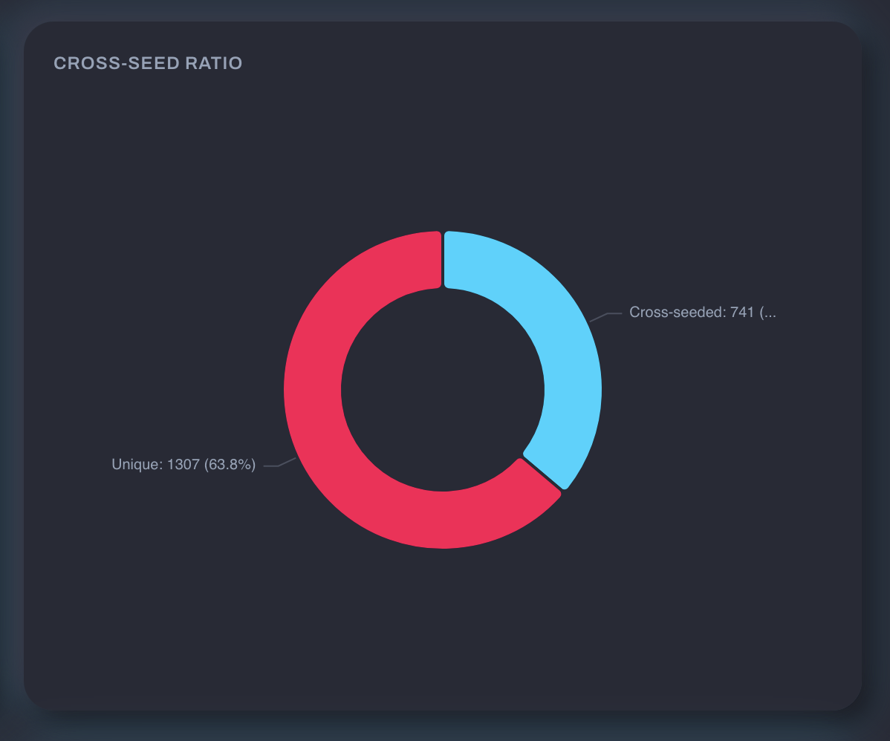

# Download Clients

Tracker Tracker connects to qBittorrent's Web API, Transmission's RPC or rTorrent's XML-RPC to pull live torrent data. This powers the Torrents tab with active downloads and uploads, speeds, seeding counts, ratio histograms, and cross-seed stats.

## Supported Clients

| Client       | Status                                   |
| ------------ | ---------------------------------------- |
| qBittorrent  | Supported                                |
| Transmission | Supported                                |
| Deluge       | Not supported yet. Contributions welcome |
| rTorrent     | Supported                                |

## Adding a Client

Go to **Settings → Download Clients** and fill in your connection details:

| Field    | Notes                                                                                                                                      |
| -------- | ------------------------------------------------------------------------------------------------------------------------------------------ |
| Name     | A label for this client                                                                                                                    |
| Type     | qBittorrent, Transmission or rTorrent. Fixed once the client is added. To switch, delete the client and add a new one                     |
| Host     | Hostname or IP, do **not** include `http://` or `https://`                                                                                 |
| Port     | `8080` for qBittorrent, `9091` for Transmission and `80` for rTorrent by default. Choosing a type fills it in                             |
| Username | The qBittorrent Web UI or Transmission RPC username, or for rTorrent the web server's username                                            |
| Password | The qBittorrent Web UI or Transmission RPC password, or for rTorrent the web server's password                                            |
| Use SSL  | Enable if the client is served over HTTPS                                                                                                  |
| URL path | Optional. For qBittorrent, a reverse proxy path or Qui's client proxy at `<base path>/proxy/<client API key>`. For Transmission, it replaces the default `/transmission` path, and `/rpc` is added after it. For rTorrent, it replaces the default `/RPC2` path with wherever the XML-RPC is mounted, such as `/xmlrpc`. Stored encrypted and shown masked |

!!! warning "SSL/port mismatch"
    The form will warn you if SSL is on with port 80, or SSL is off with port 443. These combinations are usually misconfigured. You can still save, but double-check your settings.

!!! tip "Qui"
    To go through Qui, set Host and Port to Qui's and the URL path to its client proxy, `<base path>/proxy/<client API key>`.
    Leave the username and password blank. Qui answers the qBittorrent login itself.
    If Qui is served over HTTPS, turn on **Use SSL** on the client's card after adding it.

!!! tip "Transmission"
    Transmission has no API key login. Use the RPC username and password, or leave both blank if `rpc-authentication-required` is off.
    If Transmission's `rpc-whitelist` is on, add this app's IP to it. If you reach it by hostname with authentication off, add the hostname to `rpc-host-whitelist`.
    Transmission's poll carries no swarm counts, so the S/L column shows the peers connected to you for its torrents, not the whole swarm.
    Tracker Tracker reads only Transmission's private torrents. Public ones never appear and don't count toward the per-client torrent limit, even with a tracker's label.

!!! tip "rTorrent"
    rTorrent has no web API of its own. Tracker Tracker talks XML-RPC to the web server in front of it: ruTorrent's or rflood's `/RPC2`, or an nginx or lighttpd SCGI mount. A raw SCGI port is not supported.
    The username and password are that web server's. There is no API key login.
    On a [Whatbox](https://whatbox.ca/wiki/transdroid) slot, use the WebUI host from your Manage page, port `443`, **Use SSL** on, URL path `/xmlrpc`, and your slot username and password.
    rTorrent has one label per torrent, which the \*arr apps and ruTorrent use like a qBittorrent category. Tracker Tracker shows it as the category, not as a tag, so rTorrent torrents are linked to trackers by announce domain.
    Swarm counts come from tracker scrapes, and fall back to the peers connected to you when a tracker has not answered one.
    Tracker Tracker reads only rTorrent's private torrents, as with Transmission.

After saving, use the **Test Connection** button to confirm Tracker Tracker can reach and authenticate with the client.

## Linking Trackers to a Client

A torrent with a tracker's **client tag**, a qBittorrent tag or a Transmission label, goes to that tracker. rTorrent labels are not tags, so rTorrent torrents always match by announce domain. A torrent without one is matched by its announce domain, ignoring subdomains, against each tracker's site and any other domains Tracker Tracker knows it announces on. If a torrent's tag and announce domain point to different trackers, the tag wins. Tags are optional for torrent lists and fleet stats, but the per-tag speed and seeding charts and the movers in Today at a Glance count tagged torrents only. To set a tag, open the tracker's settings and fill in the Client Tag field.

## How Polling Works

Tracker Tracker runs two polling loops:

=== "Live speed (every 5 seconds)"

    Lightweight request for current upload/download speeds. Displayed in the sidebar and uptime tracker.

=== "Full torrent data (every 5 minutes by default)"

    Fetches the full torrent list and records per-tag seeding and leeching counts and speeds as snapshots. The tracked torrents, tagged or matched by announce domain, are cached too, so the Torrents tab works even if the client is briefly offline. Set each client's **Poll Frequency** to 1, 2, 5 or 10 minutes on its card.

Both loops reuse the same session. qBittorrent logs in again only after a 403, and Transmission takes a fresh session id whenever it answers 409.

## Cross-Seed Detection

If you use [cross-seed](https://cross-seed.org/) to find matching torrents across trackers, configure cross-seed tags on the download client. Any torrent with one of those tags is counted separately in the cross-seed stats, so you can see how many torrents are cross-seeded vs. original grabs.

Set cross-seed tags in the client settings after adding it. Common tags are `cross-seed` (the default) or category-based like `cs-link-movies`, `cs-link-tv`.

For more on setting up cross-seed itself, see the [cross-seed documentation](https://cross-seed.org/docs/basics/getting-started).

## Privacy: What Gets Stripped

Tracker Tracker removes these fields from torrent data before caching or displaying:

- Announce URLs (which contain your tracker passkey)
- File paths on disk

This applies everywhere: dashboard, cached lists, API responses.

## Credential Security

Your client's username, password, API key and URL path are encrypted at rest. They're decrypted only in server memory, when Tracker Tracker needs them, and they're never logged.

## Troubleshooting

| Error                                                     | Meaning                                                                                          |
| --------------------------------------------------------- | ------------------------------------------------------------------------------------------------ |
| `ECONNREFUSED`                                            | The client is not running, or the port is wrong                                                  |
| `ENOTFOUND`                                               | The hostname couldn't be resolved. Check for typos                                               |
| `ETIMEDOUT` / timed out after 15s                         | The client didn't respond in time. Check that it's reachable from the Docker container           |
| `Authentication failed. Check username and password`      | Wrong credentials                                                                                |
| `Authentication failed. SID cookie not found in response` | Unexpected response from qBittorrent. Check that the Web UI is enabled in qBittorrent's settings |
| `Blank login rejected through the URL path`               | Qui refused the client API key in the path, or qBittorrent behind it refused blank credentials   |
| `qBittorrent's API was not found at this address`         | Something answered, but not qBittorrent's Web API. Check the port and the URL path               |
| `Credentials rejected by Transmission`                    | Wrong RPC username or password, or blank ones while Transmission requires them                   |
| `Transmission refused the connection`                     | Its `rpc-whitelist` leaves out this app's IP, or its anti-brute-force lockout tripped. A restart clears the lockout |
| `Transmission refused this hostname`                      | Add the hostname to `rpc-host-whitelist`, or turn on password authentication                     |
| `Transmission's RPC was not found at this address`        | Something answered, but not Transmission's RPC. Check the port and the URL path                  |
| `Transmission redirected the request`                     | Something at this address redirects, often a proxy. Check the URL path                           |
| `Transmission did not accept the session id`              | A proxy in front of Transmission drops the `X-Transmission-Session-Id` header                    |
| `Credentials rejected by rTorrent`                        | The web server in front of rTorrent refused the username and password                            |
| `rTorrent's XML-RPC was not found at this address`        | Something answered, but nothing is mounted at this path. Check the port and the URL path         |
| `rTorrent sent an unexpected response`                    | Something answered with a page instead of XML-RPC, often a login page. Check the URL path        |
| `rTorrent refused the request`                            | rTorrent answered with an XML-RPC fault. It may be too old to know `d.multicall2`               |

The Test Connection button forces a fresh login, so errors reflect the current state.
