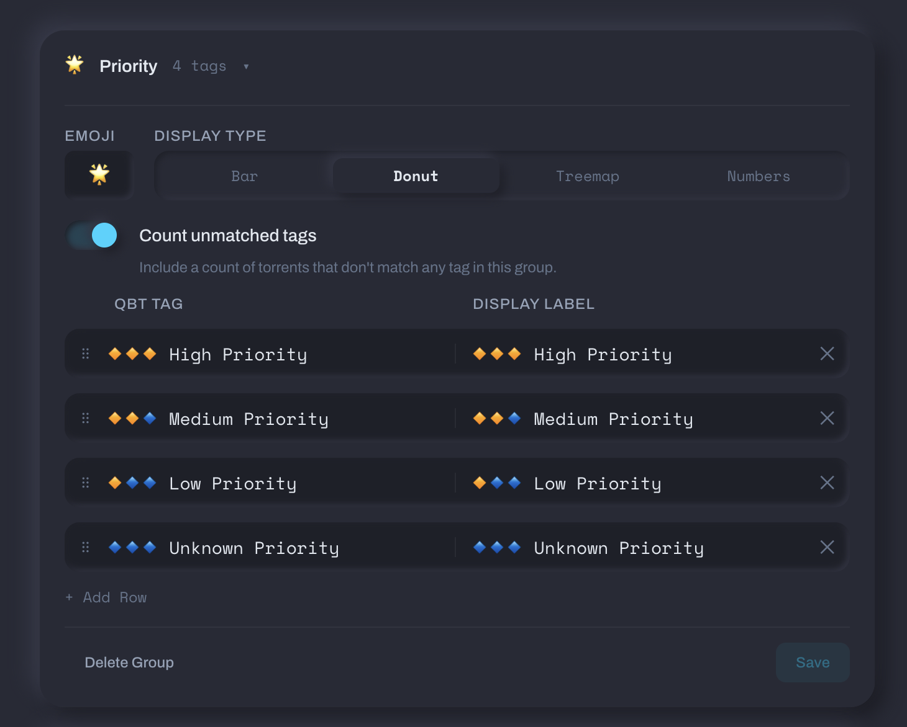
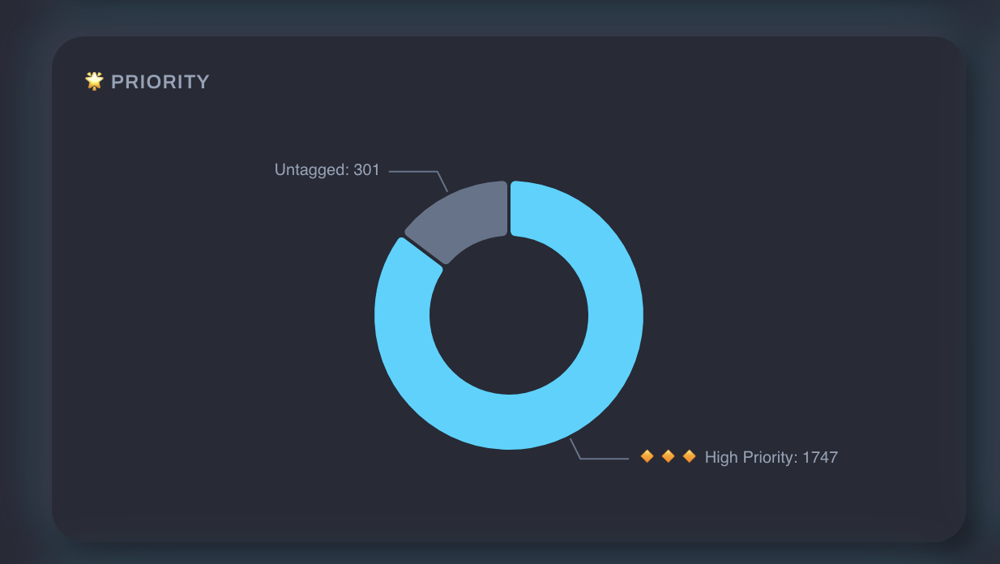
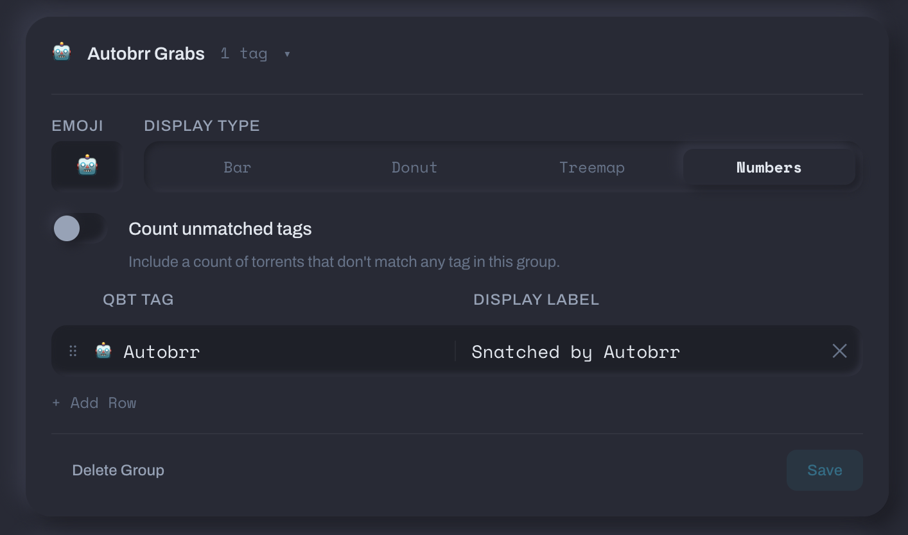
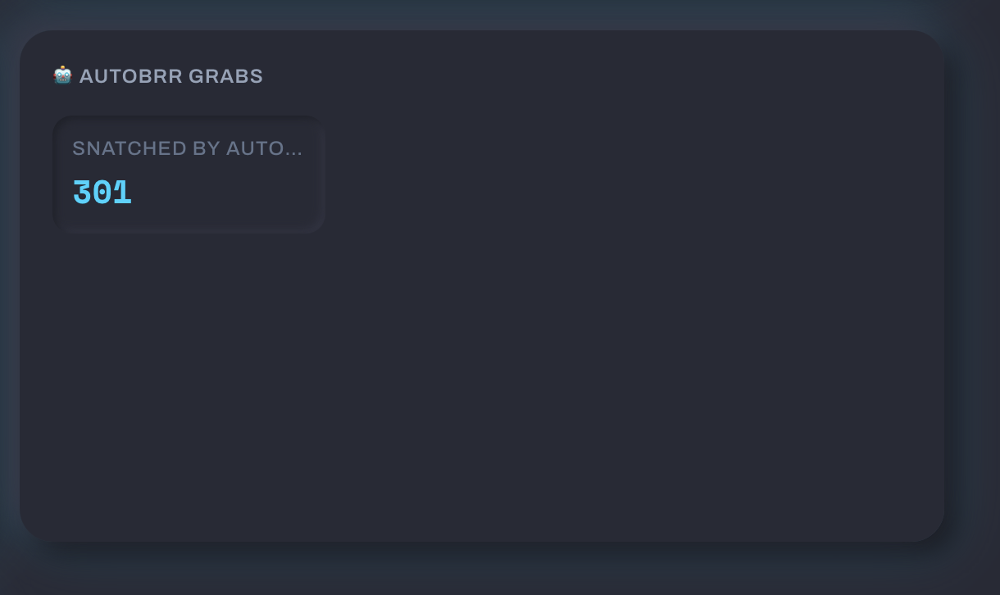
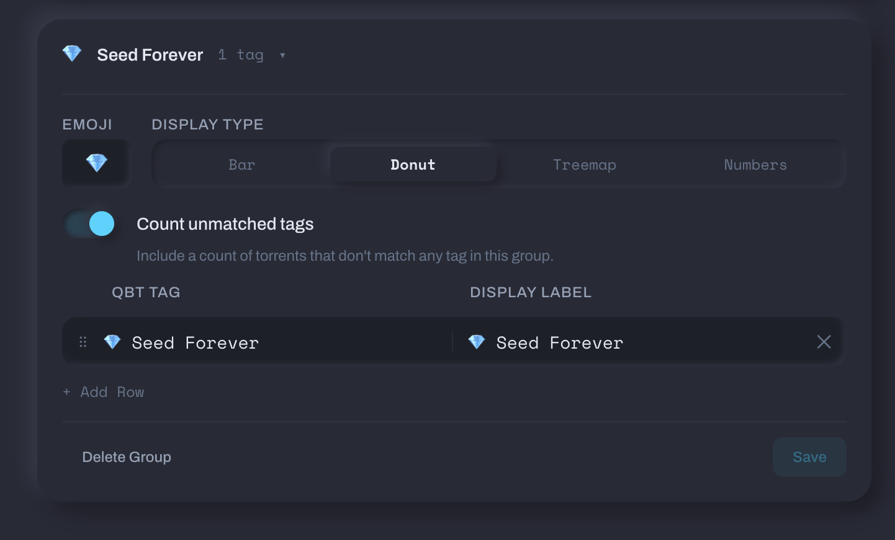
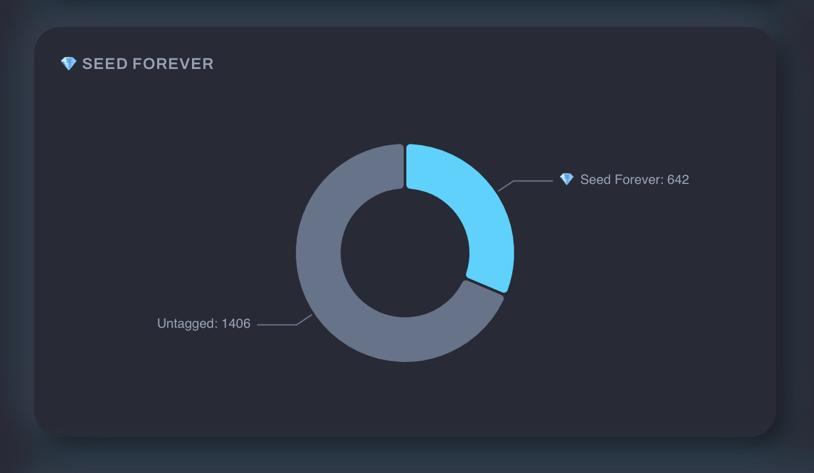

# Tag Groups

Tag groups turn qBittorrent tags into charts on each tracker's Torrents tab. Define them once and they appear everywhere.

## What They're For

Examples:

Priority breakdown: group your `High Priority`, `Medium Priority`, `Low Priority`, and `Unknown Priority` tags into one group. See the split as a donut chart.

This is what the Priority group looks like on a tracker's Torrents tab:

Automation tracking: create an "Autobrr Grabs" group with your `Autobrr` tag to see how many torrents were auto-snatched. The numbers display type suits single-tag groups.

Long-term seeds: a "Seed Forever" group with one tag tracks how many torrents you've committed to permanent seeding.

## Creating a Tag Group

1. Go to **Settings → Download Clients** and scroll past your client cards
2. Click **Add Tag Group**
3. Name it and pick an emoji
4. Add rows mapping **qBittorrent tags** (exact strings) to **display labels** (what appears in the chart)
5. Save

The group appears on the Torrents tab for trackers with matching torrents. With no matches, the chart doesn't appear.

## Display Types

Each group can use a different chart style:

| Type    | Best for                          |
| ------- | --------------------------------- |
| Bar     | Comparing counts across many tags |
| Donut   | Showing proportions of a whole    |
| Treemap | Dense view with lots of tags      |
| Numbers | Simple counts, no chart           |

## Count Unmatched Tags

Enable this to add a segment for torrents with no tag in the group. Use it to see what's still uncategorized.

## Tag Matching

Tags are case-sensitive and must match exactly. If qBittorrent says `High Priority`, typing `high priority` won't work.

!!! tip "Check your qBittorrent tags"
    Open qBittorrent and look at the tag list in the sidebar to see the exact tag names. Copy them character-for-character into Tracker Tracker.

## Automating with qbitmanage

If you use [qbitmanage](https://github.com/StuffAnThings/qbit_manage) to automate tagging in qBittorrent, tag groups pick up its tags automatically. qbitmanage writes the tags, and Tracker Tracker reads them. See the [qbitmanage Integration](qbitmanage.md) page for setup examples including priority breakdowns, seed-forever tracking, and share limit health monitoring.

## Editing and Reordering

- Rename: double-click the group name
- Reorder tags: drag the handle on the left
- Remove a tag: click the X on the right
- Delete a group: click Delete Group at the bottom (it asks you to confirm)

## Good to Know

- Tag groups are global, so one group works across all trackers.
- Changes take effect when you reload a tracker page.
- Backups include tag groups and restore them automatically.
