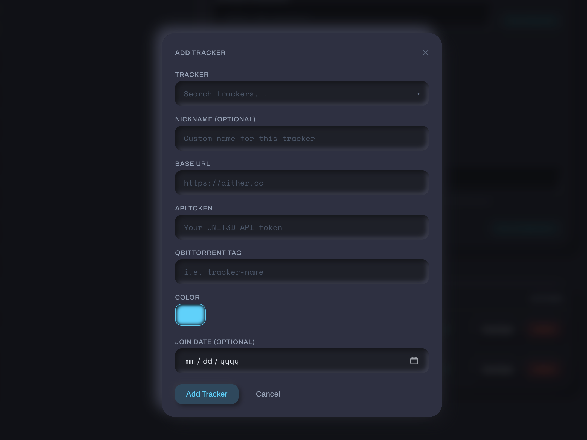
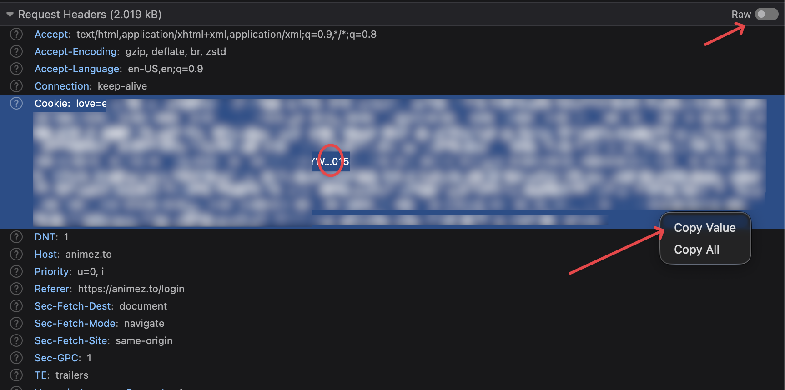
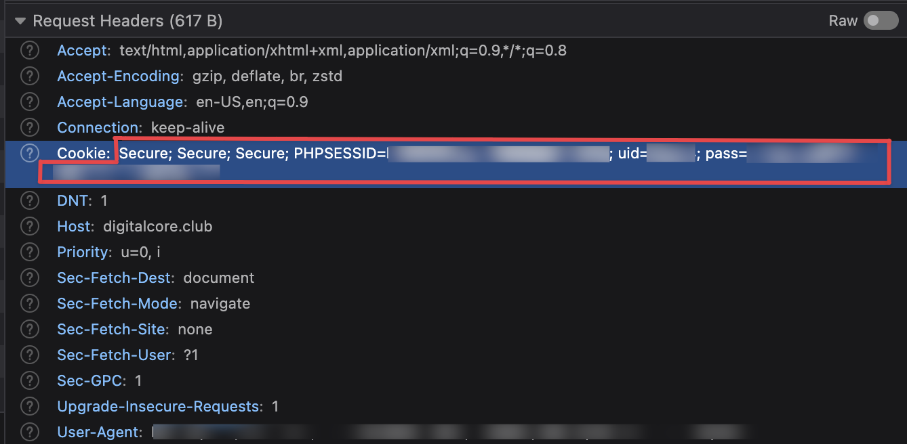

# Adding a Tracker

Tracker Tracker works with 40+ trackers. Pick one from the list below.

## Open the Add Tracker dialog

Click the **+** button next to "Trackers" in the sidebar, or go to `/trackers/new`.

## Tracker registry

=== "UNIT3D"

    | Name               | Abbreviation |
    | ------------------ | ------------ |
    | Aither             | ATH          |
    | Blutopia           | BLU          |
    | Concertos          | CON          |
    | DarkPeers          | DP           |
    | DreadVault         | DV           |
    | FearNoPeer         | FNP          |
    | InfinityHD         | IHD          |
    | LST                | LST          |
    | Luminarr           | LUME         |
    | OldToons           | OT           |
    | OnlyEncodes        | OE           |
    | Racing4Everyone    | R4E          |
    | ReelFliX           | RFX          |
    | Retro Movies Club  | RMC          |
    | RocketHD           | RHD          |
    | SeedCore           |              |
    | seedpool           | SP           |
    | SkipTheCommercials | STC          |
    | Upload.cx          | UCX          |
    | Yu-Scene           | yus          |
    | Zenith             | ZN           |

=== "Gazelle"

    | Name              | Abbreviation |
    | ----------------- | ------------ |
    | AlphaRatio        | AR           |
    | BroadcasTheNet    | BTN          |
    | Empornium         | EMP          |
    | Great Poster Wall | GPW          |
    | MoreThanTV        | MTV          |
    | Orpheus           | OPS          |
    | PassThePopcorn    | PTP          |
    | Phoenix Project   | PP           |
    | REDacted          | RED          |

=== "GGn"

    | Name         | Abbreviation |
    | ------------ | ------------ |
    | GazelleGames | GGn          |

=== "Nebulance"

    | Name      | Abbreviation |
    | --------- | ------------ |
    | Anthelion | ANT          |
    | Nebulance | NBL          |

=== "AvistaZ"

    | Name      | Abbreviation |
    | --------- | ------------ |
    | AvistaZ   | AvZ          |
    | AnimeZ    | AnZ          |
    | CinemaZ   | CZ           |
    | ExoticaZ  | ExZ          |
    | PrivateHD | PHD          |

=== "DigitalCore"

    | Name             | Abbreviation |
    | ---------------- | ------------ |
    | DigitalCore.Club | DCC          |

=== "RetroToon"

    | Name            | Abbreviation |
    | --------------- | ------------ |
    | RetroToon World | RTW          |

=== "TR4KER"

    | Name   | Abbreviation |
    | ------ | ------------ |
    | TR4KER | TR4K         |

=== "C411"

    | Name | Abbreviation |
    | ---- | ------------ |
    | C411 | C411         |

=== "AnimeBytes"

    | Name       | Abbreviation |
    | ---------- | ------------ |
    | AnimeBytes | AB           |

=== "FileList"

    | Name     | Abbreviation |
    | -------- | ------------ |
    | FileList | FL           |

=== "HAWKE-UNO"

    | Name      | Abbreviation |
    | --------- | ------------ |
    | HAWKE-UNO | HU           |

=== "IPTorrents"

    | Name       | Abbreviation |
    | ---------- | ------------ |
    | IPTorrents | IPT          |

=== "MyAnonaMouse"

    | Name         | Abbreviation |
    | ------------ | ------------ |
    | MyAnonaMouse | MAM          |

=== "TorrentLeech"

    | Name         | Abbreviation |
    | ------------ | ------------ |
    | TorrentLeech | TL           |

=== "Luminance"

    | Name             | Abbreviation |
    | ---------------- | ------------ |
    | Cathode-Ray.Tube | CRT          |

!!! note "Draft entries"
    Some trackers show a dashed border saying "Stats tracking not yet supported." You can pin them as quicklinks, but they won't poll yet.

Added trackers hide from the list automatically.

## Required fields

### API token

Location varies by platform:

=== "UNIT3D"

    Go to **Settings → Security → API Token** or **Settings → API** in your account.

    Copy the entire alphanumeric string.

    !!! tip "Token rotation"
        Some UNIT3D trackers regenerate your token when you change your password. If polls stop working after a password change, grab a fresh token.

=== "Gazelle"

    - **RED / OPS**: **Settings → Access Settings → API Keys**. Create a new key (read-only is fine).
    - **BTN / PTP / others**: check **Settings → Security**, **Settings → API**, or your profile.

    Gazelle shows keys only once when created, so copy it right away.

    !!! tip "Scoped keys"
        Some Gazelle forks support limited-permission keys. Since Tracker Tracker only reads your stats, read-only access works great.

=== "GGn"

    Go to **Settings → Access Settings → API Key** and copy it.

    GGn keys don't expire automatically, but you can regenerate them anytime from your settings.

=== "AvistaZ"

    AvistaZ uses browser cookies instead of API keys.

    1. Open the tracker in your browser and log in
    2. Open DevTools (F12 or Cmd+Option+I)
    3. Go to the **Network** tab
    4. Refresh the page
    5. Click any request to the tracker's domain
    6. Find the `Cookie` header in **Request Headers**
    7. **Right-click** the Cookie header and select **Copy Value**

    

    You'll also need your **username** on that tracker.

    Paste both into the Add Tracker dialog. The User-Agent gets captured automatically.

    !!! danger "Do not select and copy the Cookie value directly"
        Firefox (and some Chromium browsers) truncate long header values in the display, replacing the end with `…`. If you select the text and copy it, you'll get the truncated version with the ellipsis character embedded. This causes a "Tracker test failed" error.

        Always use **right-click → Copy Value** to get the full, untruncated cookie string.

    !!! warning "Cookie expiration"
        The Cloudflare `cf_clearance` cookie expires periodically. When polling fails, refresh it by repeating the steps above.

    !!! warning "Newbie rank not supported"
        AvistaZ restricts Newbie accounts to limited site access. You need **Member** rank (5 GB upload, ratio ≥ 1.0, 7+ days old) before the profile page shows the data Tracker Tracker needs. Wait until promotion before adding the tracker.

=== "DigitalCore"

    DigitalCore uses session cookies instead of API keys.

    1. Open [digitalcore.club](https://digitalcore.club) in your browser and log in
    2. Open DevTools (F12 or Cmd+Option+I)
    3. Go to the **Network** tab
    4. Refresh the page
    5. Click any request to `digitalcore.club`
    6. Find the `Cookie` header in **Request Headers** and copy its full value

    The string will contain `uid=...` and `pass=...` among other values. Paste the entire thing into the Add Tracker dialog. Tracker Tracker extracts what it needs automatically.

    

    !!! tip "Alternative: Application tab method"
        Go to **Application** → **Cookies** → `digitalcore.club` and copy the `uid` and `pass` values. Paste them as `uid=12345; pass=abc123...`.

    !!! tip "Use the same browser for both"
        Tracker Tracker also records the User-Agent of whichever browser you paste from, so polls match the session your cookies came from. Add or update DigitalCore from the same browser you are logged into DigitalCore in. Pasting from a different browser stores a User-Agent that does not match the cookies.

    !!! warning "Cookie expiration"
        Session cookies expire when you log out or after extended inactivity. If polling fails with "Session expired," log back into DigitalCore and re-copy the cookie values.

    !!! info "DigitalCore's API key won't work"
        DigitalCore has an API key feature, but it only allows access to torrent search endpoints. User stats require session cookies, which is why Tracker Tracker uses the cookie approach.

=== "TorrentLeech"

    TorrentLeech has no stats API, so Tracker Tracker logs in with your **username and password** and reads your profile page. The password is encrypted at rest with the same key as every other tracker credential.

    !!! tip "2FA accounts need the Alt 2FA Token"
        If your account has 2FA enabled, also fill in the **Alt 2FA Token** field. Find it on the site under **Site Profile → Alt 2FA Token**. It is a static token made for third-party clients, not the rotating 6-digit code. Without it, adding the tracker fails with a message asking for it.

    !!! warning "Re-entering credentials"
        Changing the stored credentials later replaces all of them at once. A 2FA account needs the token typed again alongside the username and password.

=== "RetroToon World"

    RetroToon's API key is upload-only, so Tracker Tracker reads your stats from your logged-in session instead.

    1. Open [retrotoon.world](https://retrotoon.world) in your browser and log in
    2. Open DevTools (F12 or Cmd+Option+I)
    3. Go to the **Network** tab
    4. Refresh the page
    5. Click any request to `retrotoon.world`
    6. Find the `Cookie` header in **Request Headers**
    7. **Right-click** the Cookie header and select **Copy Value**

    Paste it into the Add Tracker dialog. The User-Agent gets captured automatically, so add or update RetroToon from the same browser you are logged in with.

    !!! info "The `rt_` API key will not work here"
        **Settings → API Keys** issues keys for `/api/upload.php` only, for pushing torrents from batch tools. No RetroToon endpoint returns user stats, and the key does not authenticate ordinary pages. The Torznab passkey on the Prowlarr page is search-only. Cookies are the only way in.

    !!! warning "Cookie expiration"
        Session cookies expire when you log out or after a long idle period. When polling fails with "Session expired," log back in and re-copy the cookie string.

    !!! danger "Do not select and copy the Cookie value directly"
        Firefox (and some Chromium browsers) truncate long header values in the display, replacing the end with `…`. Copying the selection gets the truncated version with the ellipsis embedded, which fails with a "Tracker test failed" error. Always use **right-click → Copy Value**.

=== "TR4KER"

    Create an API key in your TR4KER account and paste it into the Add Tracker dialog.

    !!! warning "Unverified"
        TR4KER support hasn't been tested against a live account. If a poll fails or a stat looks wrong, open an issue naming the tracker.

=== "C411"

    Create an API key on C411 and tick the **Profile (reading)** scope while you create it. A new key does not get that scope by default, and a key's scopes cannot be changed afterwards.

    !!! warning "A key without the Profile scope reads as an authentication failure"
        C411 refuses such a key with a 403, which shows as "Authentication failed". Create a new key with the scope ticked and replace the old one.

=== "AnimeBytes"

    Create an API key in your AnimeBytes account and paste it into the Add Tracker dialog, along with your AnimeBytes **username**.

    The AnimeBytes API does not report the username, so type it as it appears on the site. Tracker Tracker shows it as entered and cannot check it.

    !!! warning "Unverified"
        AnimeBytes support hasn't been tested against a live account. If a poll fails or a stat looks wrong, open an issue naming the tracker.

=== "Luminance"

    Luminance has no stats API, so Tracker Tracker logs in with your **username and password** and reads your profile page. The password is encrypted at rest with the same key as every other tracker credential.

    !!! tip "2FA accounts use a session cookie instead"
        Tracker Tracker cannot log in to an account with 2FA. Fill in your username and the **Session Cookie (2FA accounts)** field, and leave the password empty.

        1. Log in on the site in your browser with **Lock this session to my IP address** unticked, since polls come from the machine running Tracker Tracker. Tick **Stay logged in** so the session lasts.
        2. Open DevTools (F12 or Cmd+Option+I) and go to the **Network** tab
        3. Refresh the page and click any request to the site
        4. **Right-click** the `Cookie` request header and select **Copy Value**

        The value must include the `sid` cookie. The User-Agent gets captured with it, so add or update the tracker from the same browser you logged in with. When polling fails with "Session expired," log in again and paste a fresh cookie.

    !!! warning "Unverified"
        Luminance support hasn't been tested against a live account. If a poll fails or a stat looks wrong, open an issue naming the tracker.

!!! warning "Keep your token private"
    Your API token works like a password. Tracker Tracker encrypts it before storing it.

## Optional fields

### Proxy

If the tracker needs a proxy (i.e., for geo-restrictions), toggle **Use Proxy** on the tracker's settings page. See [Proxy Support](../features/proxies.md) for setup.

!!! tip "Getting a red dot?"
    Check your API token. Most often it's a copy-paste error or a token that rotated after you saved it.

## Poll manually

The **Poll Now** button on any tracker's detail page fetches stats immediately. Use it after updating a token or testing connectivity.

Manual polls don't interfere with the global schedule (default: every 60 minutes).

---

## What stats each platform provides

Different platforms expose different stats. Here's what you'll get:

| Stat             | UNIT3D | Gazelle | GGn     | AvistaZ | DigitalCore | RetroToon | Luminance | Notes                                                                        |
| ---------------- | ------ | ------- | ------- | ------- | ----------- | --------- | --------- | ---------------------------------------------------------------------------- |
| Upload           | Yes    | Yes     | Yes     | Yes     | Yes         | Yes       | Yes       |                                                                              |
| Download         | Yes    | Yes     | Yes     | Yes     | Yes         | Yes       | Yes       |                                                                              |
| Ratio            | Yes    | Yes     | Yes     | Yes     | Yes         | Yes       | Yes       | GGn shows extra decimal precision                                            |
| Buffer           | Yes    | Yes     | Yes     | Yes     | Yes         | Yes       | Yes       | UNIT3D returns this directly; others calculate it from upload minus download |
| Seeding count    | Yes    | Partial | Partial | Yes     | Yes         | Yes       | Yes       | Some Gazelle forks and GGn may return 0 even when you're seeding             |
| Leeching count   | Yes    | Partial | Partial | Yes     | Yes         | No        | No        | RetroToon publishes no leeching figure anywhere                              |
| Bonus points     | Yes    | Yes     | Yes     | Yes     | Yes         | Yes       | Yes       | GGn calls this "gold," DigitalCore "bonuspoang," Luminance "Credits"         |
| Hit & Runs       | Yes    | No      | Partial | Yes     | Yes         | Partial   | No        | RetroToon reports 0 reliably; a non-empty list reads as unknown for now      |
| Required ratio   | No     | Yes     | Yes     | No      | No          | No        | Yes       | Not in the UNIT3D or DigitalCore API; RetroToon enforces no account ratio    |
| Warned status    | No     | Partial | Yes     | No      | Yes         | No        | No        | Most Gazelle trackers default to false; RED has extended data                |
| Freeleech tokens | No     | Partial | No      | No      | No          | Yes       | Yes       | RetroToon calls them "freeleech slots"                                       |

### Gazelle: extra data on RED

REDacted and Phoenix Project return additional fields (warned status, join date, avatar, and detailed seeding/leeching counts), which gives you richer info than other Gazelle trackers.

### GGn quirks

- **Seeding/leeching can show 0**: GGn's API doesn't always expose these counts. That's normal.
- **Hit & Runs shows unknown** for Elite Gamer and above, because those classes are HNR-immune.
- **Gold, not seedbonus**: GGn calls bonus currency "gold," which we map to the bonus points field.

---

## Troubleshooting

### Token not working

Make sure you copied the full token. UNIT3D tokens are usually 60-80 characters. Gazelle shows keys only once when you create them.

### Poll fails with 401

Your token expired or was regenerated. Get a fresh token from the tracker's settings and update it.

### Bonus points show unavailable

Some heavily customized Gazelle forks don't include bonus points in their API. The tracker just doesn't expose it.

### Seeding count always shows 0

Some Gazelle forks and GGn don't expose seeding counts via their API. If you're seeding but see 0, it's a platform limitation.

### Warned status always shows false

That's expected for most Gazelle trackers. Only RED and Phoenix Project provide this.
